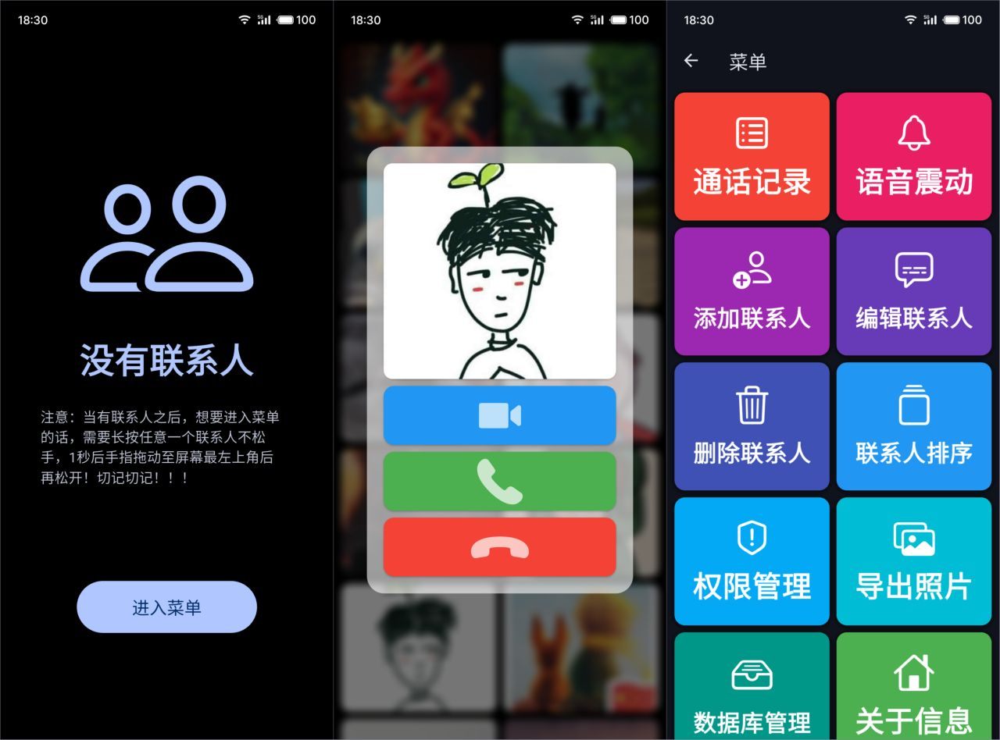

# Call打电话

一个工具类APP，用于老人快捷方便拨打家人电话、微信视频通话。使用Flutter编写。

## 功能特点

- 点击头像拨打普通电话、微信视频通话
- 添加、编辑、删除联系人姓名、图片、微信昵称/备注、语音播报内容
- 查询通话记录（电话、微信）
- 设置语音播报TTS音量、语速，点击联系人震动时长、强度
- 联系人拖动排序
- 权限管理（无障碍、微信坐标校准、悬浮窗、打电话、相册、设置）
- 导出联系人照片
- 联系人数据库管理
- 手机系统信息查看

## 微信视频（wechat_video_call 2.0）

本应用依赖 [wechat_video_call](https://pub.dev/packages/wechat_video_call) `^2.0.0`。2.0 改为**用户校准坐标**方案，与 1.x 有破坏性差异：

1. **必须先校准**：每台手机/微信布局在拨号前用「微信坐标校准」悬浮向导录点，否则会提示 `缺少校准配置`。
2. **权限**：无障碍用于自动点击；悬浮窗仅校准向导需要。从系统设置返回后 App 会自动刷新状态（`request*Permission` 返回的是当时状态，不能当作最终结果）。
3. **拨号语义**：`videoCall` 返回 `true` 仅表示会话启动，是否接通只能在微信中查看。失败码可用插件 `errorMessage` 展示。
4. **入口**：仅当无障碍开启、已装微信且校准就绪时，联系人弹窗才显示视频按钮；红色按钮挂断（长按取消会话）。
5. **配置备份**：权限页长按「微信坐标校准」可导入/导出/重置录点。

开发环境需 Flutter ≥ 3.24、Dart ≥ 3.13（插件 `sdk: ^3.13.4`）。

## 界面预览



## 开发环境

- Flutter 3.47.x (stable)
- Dart 3.13.x
- Gradle 9.1.0
- Android Gradle Plugin 9.0.1
- Kotlin 2.3.20
- compileSdk 36 / minSdk 26
- JDK 17

## 构建与发布

支持 4 个渠道风味（`che`、`ou`、`hds`、`github`），通过 flutter_distributor 打包：

```bash
dart pub global activate flutter_distributor
flutter_distributor release --name che
```

产物输出到 `dist/` 目录。所有渠道均使用 `--obfuscate --split-debug-info build/symbols/apk` 混淆构建，符号文件保存在 `build/symbols/apk`，用于崩溃日志还原。

### CI 工作流

| 工作流 | 触发时机 | Flutter 渠道 | 内容 |
| --- | --- | --- | --- |
| `build.yml` | push main / 新建 PR | beta | `dart analyze` + 构建 `che` 并上传 artifact |
| `manual.yml` | 手动触发 | beta / master / stable 可选 | `dart analyze` + 构建 `che` 并上传 artifact |
| `publish.yml` | 打 tag（如 `3.9.2+260810`） | stable | 构建全部风味并创建草稿 Release |

### 构建注意事项

- Android 工程的 lint 相关任务在 `android/build.gradle.kts` 中被跳过：`android_intent_plus`（buildscript 钉 AGP 8.13.0）、`permission_handler_android`（钉 AGP 8.0.2）等插件的 buildscript 版本与根工程 AGP 9.0.1 不一致，混载会导致 lint worker（`AndroidLintWorkAction`）崩溃，因此统一禁用了 lint 系列任务，并为 `extract*Annotations` 任务生成占位产物。
- 代码质量由 CI 中的 `dart analyze` 保证。

## 项目结构

```
Call
├─android              # Android工程配置
├─assets               # 资源文件目录
├─ios                  # iOS工程配置
├─lib                  # Flutter源代码目录
│  ├─data              # 数据类
│  ├─page              # 各个页面
│  ├─utls              # 工具类
│  └─main.dart         # APP入口
├─.github/workflows    # CI 工作流
└─test                 # 测试目录
```
